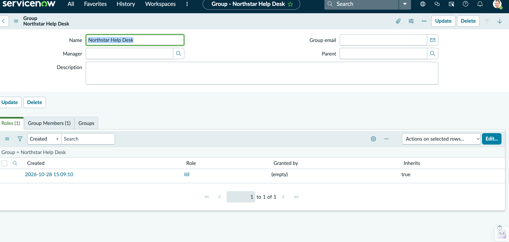
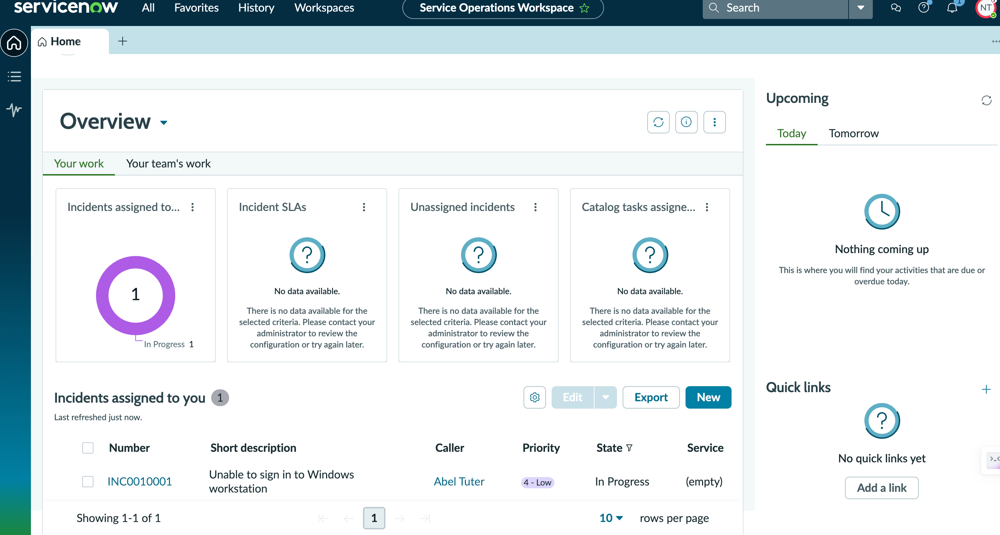
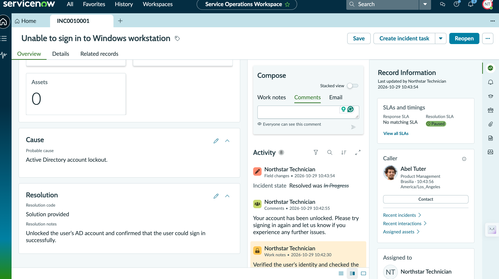
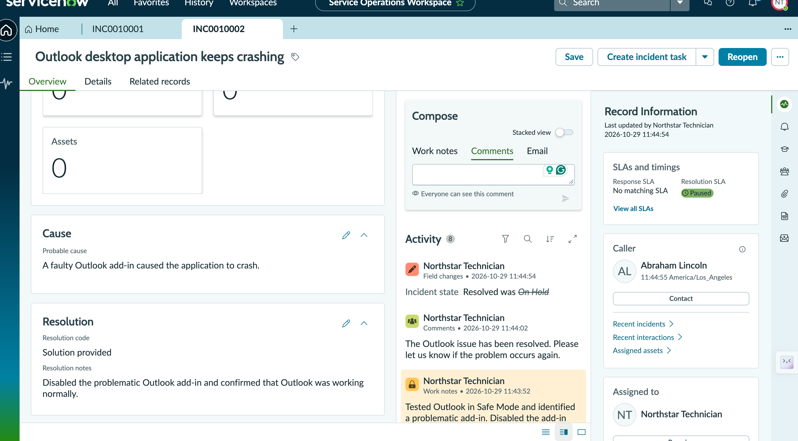
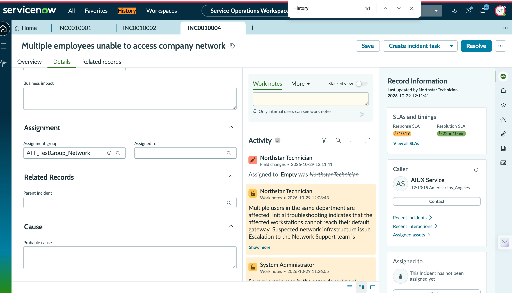
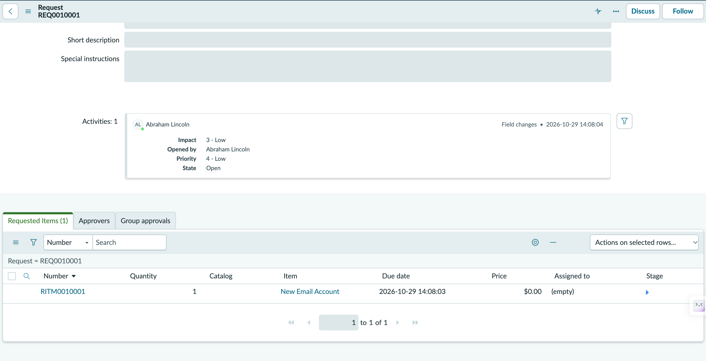
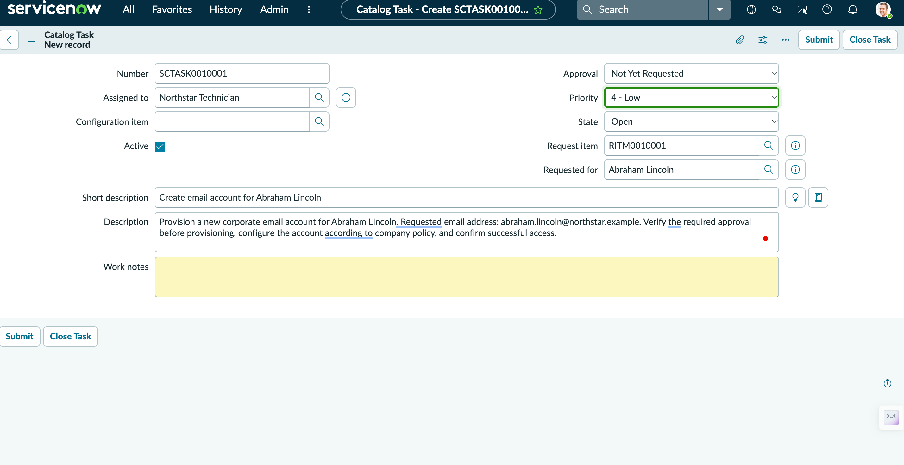
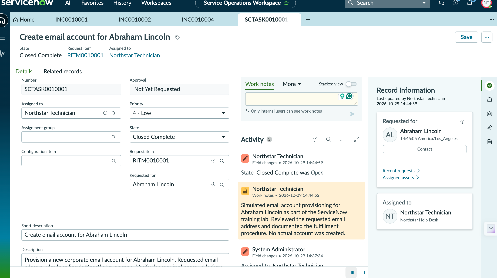

# **1. Project Overview**

This project simulates real-world IT Help Desk and Service Desk workflows using ServiceNow, focusing on incident management, service requests, ticket prioritization, escalation, SLA tracking, and documentation.

## **1.1 Lab Environment**

- **Platform:** ServiceNow (Brazil Release)
- **Environment:** Personal Developer Instance (PDI)
- **Access:** Google Chrome on macOS
- **Purpose:** Simulated enterprise IT Support operations

## **1.2 Service Desk Lab Setup**

A simulated Service Desk team was configured in the ServiceNow Personal Developer Instance to practice enterprise IT support workflows.

### **Team Configuration**

| **Component**    | **Configuration**              |
| ---------------- | ------------------------------ |
| Assignment Group | Northstar Help Desk            |
| Group Member     | Northstar Technician           |
| Assigned Role    | itil                           |
| Caller           | Existing ServiceNow test users |
| Administrator    | System Administrator           |

The **Northstar Help Desk** group and **Northstar Technician** user were created for this lab.

The Technician was added to the group, and the **itil** role was assigned at the group level following the **principle of least privilege**.

### **Incident Workflow**

The lab uses the following workflow:

1. **System Administrator** creates incidents on behalf of employees.
2. Incidents are assigned to **Northstar Help Desk** and **Northstar Technician**.
3. The administrator uses **Impersonate User** to switch to the Technician’s identity.
4. The Technician reviews assigned incidents in **Service Operations Workspace**.
5. The Technician documents troubleshooting, communicates with users, and resolves incidents.

This setup is reused across the ServiceNow lab scenarios.

##  **1.3 Project Scope**

| **Module**                     | **Core Skills**                                              |
| ------------------------------ | ------------------------------------------------------------ |
| Incident Management            | Incident creation, assignment, troubleshooting documentation, resolution |
| Ticket Queue Management        | Filtering, sorting, On Hold, follow-up, reopening            |
| Escalation & SLA               | Reassignment, escalation, SLA monitoring                     |
| Service Request Management     | Service Catalog, REQ, RITM, SCTASK, approvals, fulfillment   |
| Knowledge & Problem Management | Knowledge Base, recurring incidents, Problem records         |
| Service Desk Simulation        | Independent ticket prioritization, management, and resolution |

## **1.4 Lab Scenarios**

| **Scenario**                       | **Focus**                                           |
| ---------------------------------- | --------------------------------------------------- |
| **1. Windows Login Failure**       | Complete Incident lifecycle                         |
| **2. Pending User Response**       | Ticket queue, On Hold, follow-up, reopening         |
| **3. Network Outage**              | Functional escalation, reassignment, SLA monitoring |
| **4. New Employee Access Request** | Service request, approval, fulfillment              |
| **5. Recurring Outlook Issues**    | Knowledge Base and Problem Management               |
| **6. Service Desk Simulation**     | Independent management of multiple tickets          |

**Note:** All scenarios are simulated in a ServiceNow Personal Developer Instance. Completed operations and validation results are documented in their respective sections.

# **2. Incident Management — Windows Login Failure**

This lab simulates an employee reporting a Windows login failure and demonstrates the complete incident handling workflow in ServiceNow.

## **2.1 Scenario**

**Abel Tuter** reported that he could not sign in to his Windows workstation.

The **System Administrator** created an Incident on behalf of the employee and assigned it to the **Northstar Help Desk** group.

The incident was assigned to **Northstar Technician** for investigation and resolution.

## **2.2 Incident Handling**

| **Step**       | **Action**                                                   |
| -------------- | ------------------------------------------------------------ |
| 1. Create      | Created INC0010001 with Abel Tuter as the caller.            |
| 2. Classify    | Set Category, Impact, Urgency, and Priority.                 |
| 3. Assign      | Assigned the incident to Northstar Help Desk → Northstar Technician. |
| 4. Access      | Used Impersonate User to access the Technician’s Service Operations Workspace. |
| 5. Investigate | Simulated troubleshooting and identified an Active Directory account lockout. |
| 6. Document    | Recorded the cause, internal Work Notes, and customer-visible Comments. |
| 7. Resolve     | Documented the simulated account unlock, selected **Solution provided**, and resolved the incident. |

## **2.3 Validation**

- **Incident:** INC0010001
- **Assigned To:** Northstar Technician
- **Resolution Code:** Solution provided
- **Final State:** Resolved
- **Result:** Incident assignment, technician access, documentation, and resolution workflow successfully validated.

**Note:** The Active Directory troubleshooting and account unlock were simulated. ServiceNow ticket operations were performed in the Personal Developer Instance.

# **3. Ticket Queue Management & Follow-up**

This lab demonstrates managing multiple incidents with different priorities and handling an incident that requires customer follow-up.

## **3.1 Ticket Queue Management**

Three incidents were assigned to **Northstar Technician** and reviewed in Service Operations Workspace.

| **Incident** | **Issue**                                           | **Priority** |
| ------------ | --------------------------------------------------- | ------------ |
| INC0010004   | Multiple employees unable to access company network | P2 - High    |
| INC0010003   | Office printer not working                          | P4 - Low     |
| INC0010002   | Outlook desktop application keeps crashing          | P4 - Low     |

The network incident was identified as the highest-priority issue and retained for the Escalation & SLA exercise.

## **3.2 On Hold & Customer Follow-up**

**Incident:** INC0010002 — Outlook desktop application keeps crashing
 **Caller:** Abraham Lincoln

The employee was temporarily unavailable for remote troubleshooting.

The following workflow was performed:

1. **Customer Communication:** Requested the employee’s availability through customer-visible Comments.
2. **On Hold:** Changed the incident state from In Progress to On Hold while waiting for the employee.
3. **Follow-up:** Simulated the employee becoming available for remote troubleshooting.
4. **Investigation:** Simulated testing Outlook in Safe Mode and identifying a faulty add-in.
5. **Resolution:** Documented the simulated removal of the issue by disabling the problematic add-in.
6. **Resolved:** Updated the incident to Resolved.

## **3.3 Validation**

- Successfully reviewed multiple incidents with different priorities.
- Verified the On Hold state and customer communication in Activity History.
- Recorded troubleshooting steps using Work Notes.
- Confirmed that INC0010002 reached **Resolved** status.

**Note:** Outlook troubleshooting was simulated. Ticket state changes, documentation, and resolution were performed in ServiceNow.

# **4. Escalation & SLA Management**

This lab demonstrates functional escalation of a network incident from Tier 1 Help Desk to a specialized network support team.

## **4.1 Scenario**

**Incident:** INC0010004 — Multiple employees unable to access company network
 **Priority:** P2 - High
 **Initial Assignment:** Northstar Help Desk → Northstar Technician

Multiple employees reported network connectivity failures.

Simulated initial troubleshooting indicated that affected workstations could not reach their default gateway, suggesting a potential network infrastructure issue requiring specialized support.

## **4.2 Functional Escalation**

The following actions were performed in ServiceNow:

1. Documented the initial investigation and escalation reason in **Work Notes**.
2. Reassigned the incident from **Northstar Help Desk** to **ATF_TestGroup_Network**.
3. Cleared **Assigned To**, allowing the receiving team to assign a technician.
4. Saved the incident and verified the updated assignment.

## **4.3 SLA Monitoring & Validation**

Reviewed the incident’s Task SLA records:

| **SLA**                         | **Stage**   |
| ------------------------------- | ----------- |
| Priority 3 Resolution (1 day)   | Cancelled   |
| Priority 2 Resolution (8 hours) | In Progress |

The active P2 resolution SLA was monitored using the remaining business time.

**Validation:** The incident was successfully reassigned to the network group while remaining unresolved. Existing troubleshooting notes were preserved.

**Note:** Network troubleshooting results were simulated. ServiceNow reassignment, documentation, and SLA inspection were performed in the lab.

# **5. Service Request Management**

This lab simulates the Service Request Management process in ServiceNow, from an employee submitting an IT service request to a technician completing the assigned fulfillment task.

## **5.1 Scenario**

An employee, **Abraham Lincoln**, requests a new corporate email account through the ServiceNow Service Catalog.

The objective is to demonstrate how ServiceNow organizes service requests using three related records:

**REQ (Request) → RITM (Requested Item) → SCTASK (Catalog Task)**

The email provisioning process is simulated. No actual Active Directory or Microsoft Exchange account is created.

## **5.2 Service Request Submission**

Using ServiceNow’s **Impersonate User** feature, the administrator switched to Abraham Lincoln’s identity.

The employee then:

1. Opened **Service Catalog**.
2. Selected **New Email Account**.
3. Entered the requested email address: `abraham.lincoln@northstar.example`.
4. Submitted the request using **Order Now**.

ServiceNow generated the following records:

| **Record**            | **Number**  | **Description**            |
| --------------------- | ----------- | -------------------------- |
| Request (REQ)         | REQ0010001  | Employee’s service request |
| Requested Item (RITM) | RITM0010001 | New Email Account          |

The Request displayed an **Approved** status. However, no individual approval records were found.

## **5.3 Catalog Task Creation and Assignment**

The administrator opened RITM0010001 and reviewed its related records.

No Catalog Task had been generated automatically.

To simulate the IT fulfillment workflow, the administrator manually created a Catalog Task associated with the existing RITM.

| **Field**         | **Configuration**                        |
| ----------------- | ---------------------------------------- |
| Catalog Task      | SCTASK0010001                            |
| Request Item      | RITM0010001                              |
| Short Description | Create email account for Abraham Lincoln |
| Assigned To       | Northstar Technician                     |
| Priority          | 4 - Low                                  |
| Initial State     | Open                                     |

The task was assigned directly to Northstar Technician.

No Assignment Group was explicitly configured for this task.

## **5.4 IT Technician Fulfillment**

The administrator used **Impersonate User** to switch to Northstar Technician.

The technician:

1. Opened **Service Operations Workspace**.
2. Located the assigned Catalog Task.
3. Reviewed the task description and requested email address.
4. Documented the simulated fulfillment in **Work Notes**.
5. Changed the task status to **Closed Complete** using **Close Task**.

The Work Notes explicitly stated that the provisioning was simulated and no actual email account was created.

### **Result**

SCTASK0010001 was successfully closed.

## **5.5 Validation**

The following results were verified:

| **Validation**                    | **Result**      |
| --------------------------------- | --------------- |
| REQ created                       | Successful      |
| RITM created                      | Successful      |
| SCTASK manually created           | Successful      |
| Task assigned to technician       | Successful      |
| Technician accessed assigned task | Successful      |
| Work Notes recorded               | Successful      |
| SCTASK status                     | Closed Complete |
| RITM status after task closure    | Open            |

Closing the manually created SCTASK did not automatically close its parent RITM.

This demonstrates that task completion and parent request lifecycle management are separate operations, with automated state transitions dependent on the configured ServiceNow workflow.

**Lab limitation:** Approval execution and actual email provisioning were not performed. The exercise focused on service request tracking, task assignment, documentation, and simulated fulfillment.

# **6. ITSM Knowledge and Operational Guidelines**

This chapter summarizes additional IT Service Management (ITSM) concepts relevant to daily Help Desk operations.

It focuses on Knowledge Management, Problem Management, and Change Management.

These topics were studied conceptually and were not implemented as separate hands-on lab scenarios.

## **6.1 Knowledge Management**

Knowledge Management helps IT Support teams resolve common issues efficiently by reusing documented solutions.

### **Typical Workflow**

1. Search the ServiceNow Knowledge Base using relevant keywords.
2. Review existing troubleshooting articles.
3. Follow the documented procedures.
4. Verify whether the solution resolves the issue.
5. Document the results in the incident’s Work Notes.

If no suitable article exists, a new knowledge article may be proposed according to the organization’s review and publication process.

## **6.2 Problem Management**

Problem Management focuses on identifying and managing the underlying causes of incidents, especially recurring incidents.

### **Incident vs. Problem**

| **Incident Management**                   | **Problem Management**                         |
| ----------------------------------------- | ---------------------------------------------- |
| Restores normal service                   | Investigates underlying causes                 |
| Focuses on resolving individual incidents | Focuses on preventing recurring incidents      |
| May use temporary workarounds             | Identifies root causes and permanent solutions |

### **Typical Workflow**

1. Identify recurring incidents with similar symptoms.
2. Create or identify a related Problem record.
3. Link relevant incidents to the Problem.
4. Investigate the root cause.
5. Document known errors and available workarounds.
6. Coordinate permanent remediation when appropriate.

A Problem may remain open after an individual incident has been resolved.

## **6.3 Change Management**

Change Management, also known as Change Enablement in ITIL 4, helps organizations manage changes to IT services while controlling risks and minimizing disruption.

### **Typical Workflow**

1. Submit a Change Request.
2. Describe the proposed change and business justification.
3. Assess risks, impact, and implementation requirements.
4. Obtain required approvals.
5. Schedule and implement the change.
6. Validate the results and document the outcome.

For example, replacing a network switch or modifying a production firewall configuration may require formal change control.

### **Incident vs. Change**

Incident Management focuses on restoring service after an interruption.

Change Management focuses on planning and controlling modifications to IT systems.

A permanent fix identified during incident or problem investigation may require a Change Request before implementation.

## **6.4 Operational Best Practices**

In daily Service Desk operations, technicians should:

1. Prioritize incidents according to business impact and urgency.
2. Search existing knowledge articles before repeating troubleshooting.
3. Document investigation steps and results in Work Notes.
4. Communicate relevant updates through customer-visible Comments.
5. Escalate unresolved issues to the appropriate support team.
6. Monitor SLA deadlines and follow escalation procedures.
7. Verify the outcome before resolving or closing a ticket.

These practices support consistent service delivery, effective collaboration, and clear ticket documentation.

