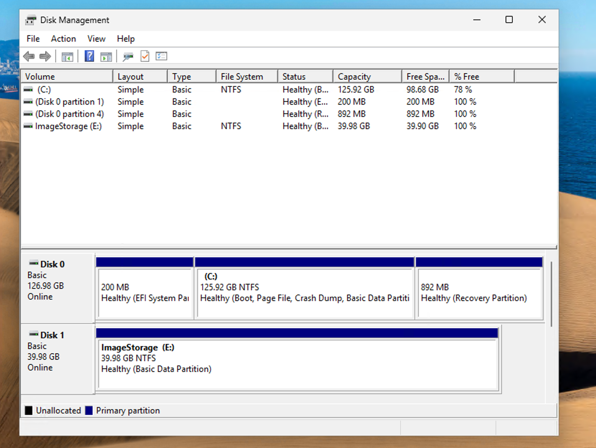
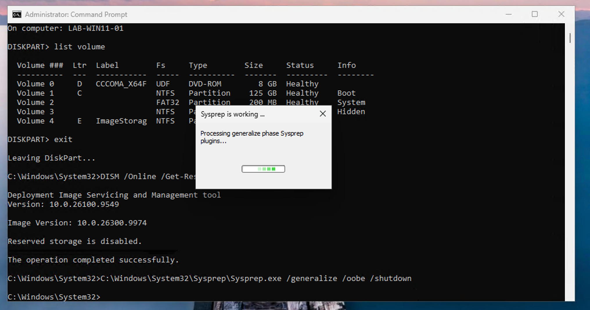
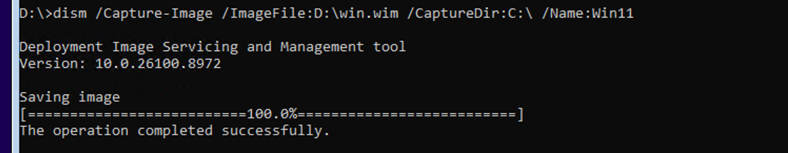
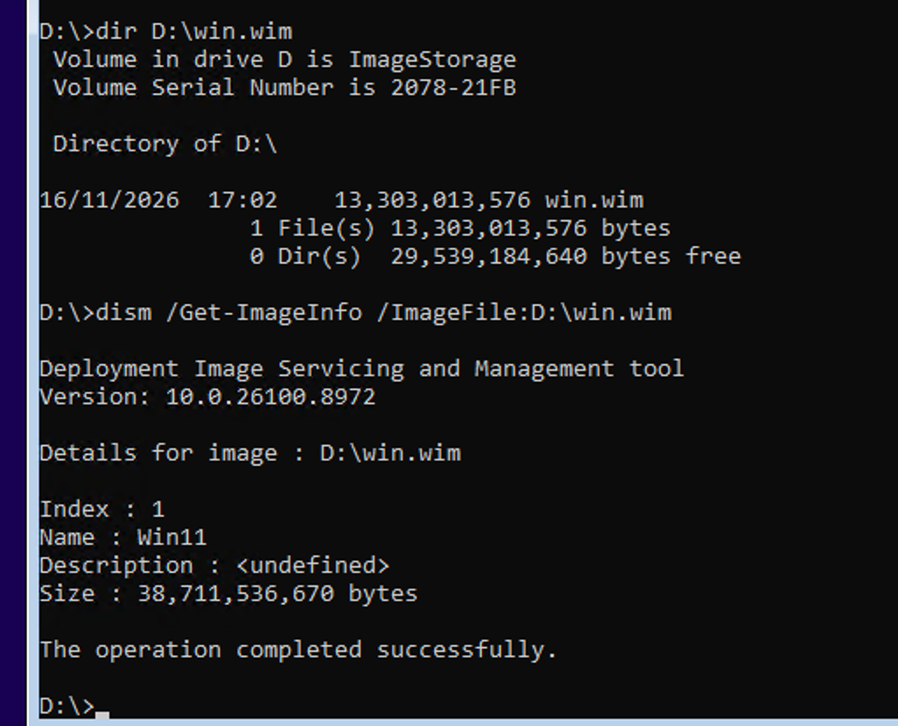
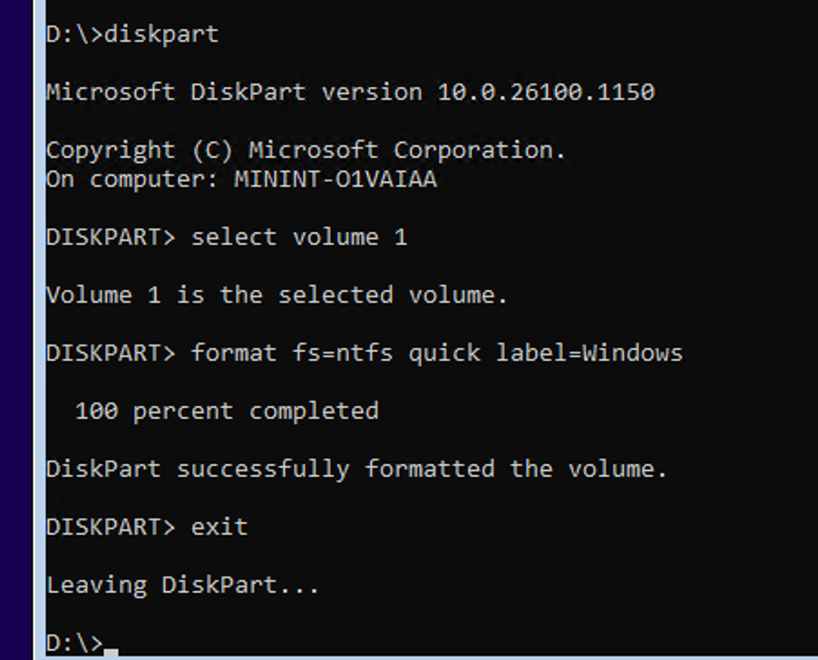
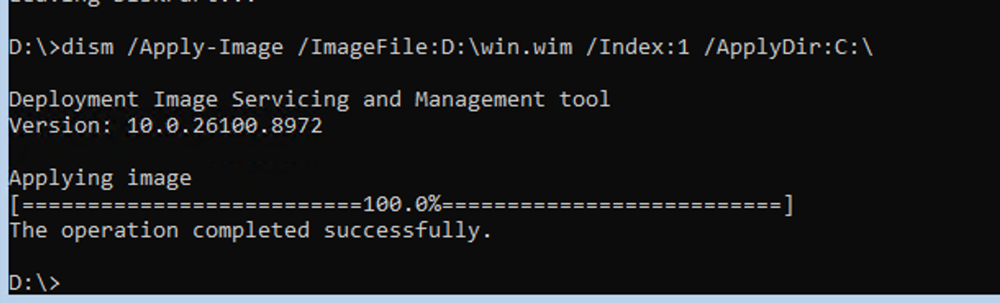
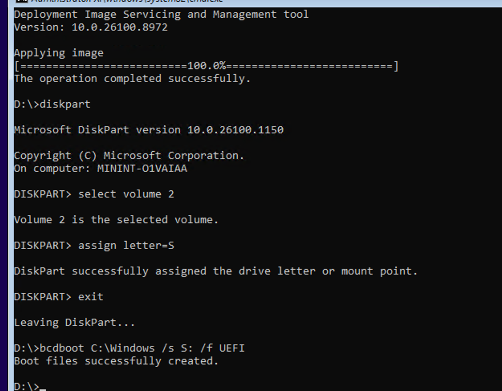

# Windows 11 Imaging and Deployment Lab

## 1. Windows 11 Reference Image Preparation

### 1.1 Overview

I used Hyper-V to practice capturing and redeploying a Windows 11 installation. I prepared the reference system with Sysprep, used DISM to capture and apply the image, and used BCDBoot to recreate the UEFI boot files.

### 1.2 Lab Environment and Disk Configuration

My Windows 11 Pro VM had two virtual hard disks. The 125 GB Windows partition was **C:**, and the separate 40 GB **ImageStorage** disk was **E:**. I stored the image on the second disk so I could format the Windows partition without losing the image.




### 1.3 Prepare the Reference System with Sysprep

I ran Sysprep to remove machine-specific information, prepare Windows to show its first-run setup after deployment, and shut down the VM.

```cmd
C:\Windows\System32\Sysprep\Sysprep.exe /generalize /oobe /shutdown
```



---

## 2. Windows Image Capture and Deployment

### 2.1 Boot into Windows PE

I booted the VM from the Windows 11 installation ISO and pressed **Shift + F10** at the setup screen to open Command Prompt. This let me work on the installed copy of Windows while it was offline.

I checked the drive letters in WinPE before capture and deployment.

| Drive  | What it contained                          |
| ------ | ------------------------------------------ |
| **C:** | 125 GB Windows partition                   |
| **D:** | ImageStorage disk, shown as 39 GB in WinPE |
| **E:** | Windows 11 installation media              |

The ImageStorage disk appeared as **E:** in Windows and **D:** in WinPE.

### 2.2 Capture the Windows Image with DISM

I captured the Windows partition on **C:** and saved it as **win.wim** on the separate **D:** drive. DISM completed the capture successfully.

```cmd
dism /Capture-Image /ImageFile:D:\win.wim /CaptureDir:C:\ /Name:Win11
```



### 2.3 Verify the Captured Image

I confirmed that **win.wim** existed on the image storage drive. Then I used DISM to check its contents. The image was named **Win11** and had index **1**.

```cmd
dir D:\win.wim
```

```cmd
dism /Get-ImageInfo /ImageFile:D:\win.wim
```



### 2.4 Prepare the Target Partition

After confirming the target volume, I used DiskPart to format only the 125 GB Windows partition. The image storage disk, EFI partition, and recovery partition were preserved. **Volume 1** was the Windows partition in this VM.

```cmd
diskpart
select volume 1
format fs=ntfs quick label=Windows
exit
```



### 2.5 Deploy the Image with DISM

I applied image index **1** from **D:\win.wim** to the formatted Windows partition on **C:**. DISM completed the deployment successfully.

```cmd
dism /Apply-Image /ImageFile:D:\win.wim /Index:1 /ApplyDir:C:\
```



### 2.6 Recreate the UEFI Boot Files

I assigned **S:** to the existing EFI System Partition. Then I used BCDBoot to create the UEFI boot files on that partition using the Windows installation I had just deployed.

```cmd
diskpart
select volume 2
assign letter=S
exit
```

```cmd
bcdboot C:\Windows /s S: /f UEFI
```

BCDBoot reported **Boot files successfully created.**



### 2.7 Project Results

I generalized a Windows 11 installation, captured and verified its WIM image, and applied it back to the formatted Windows partition. DISM reported a successful deployment, and BCDBoot confirmed that the UEFI boot files were created.
