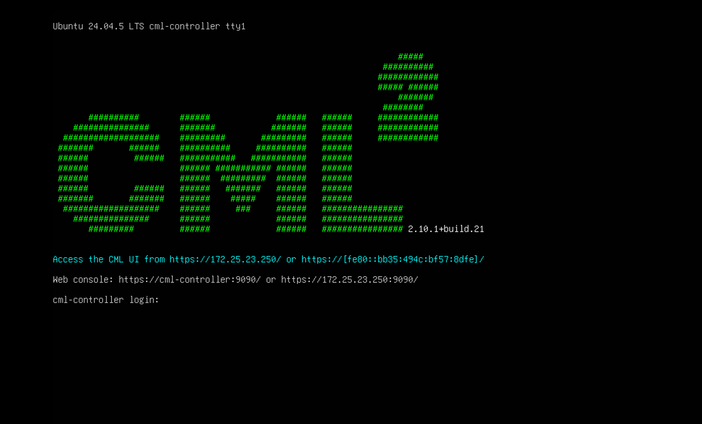
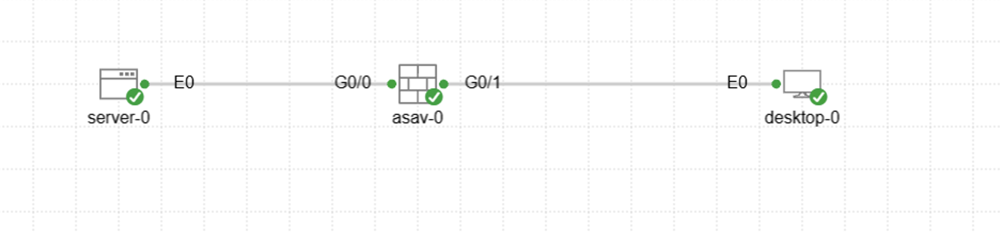
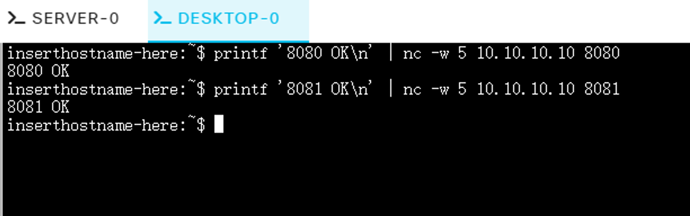
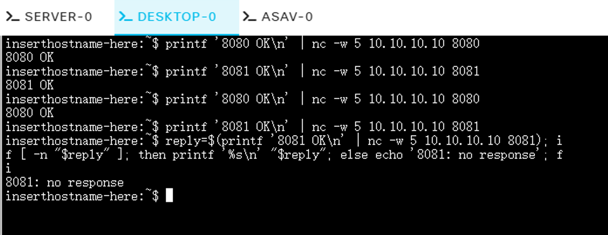
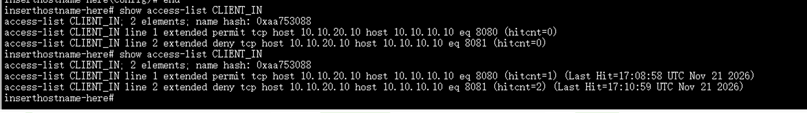

# 1. Building the Lab Environment

I created a virtual machine in Hyper-V on my Windows computer and installed Cisco Modeling Labs (CML). I then loaded Cisco’s device image package into CML so I could use the ASAv firewall and the other devices in the lab.

When CML started, it showed a web address on the screen. I opened that address in my Windows browser, created a new lab, and connected three devices: a client, an ASAv firewall, and a server.

# 2. Configuring and Testing the ASAv Firewall

## Build the lab topology

I placed three devices in CML. The server (server-0) was on the left, the Cisco ASAv firewall (asav-0) was in the middle, and the client (desktop-0) was on the right.

## Configure the network

I put the server and client on two different networks. On the ASAv, I enabled both interfaces and assigned an IP address to each one. I set each host's default gateway to the firewall interface on its own network. That way, traffic between the client and server had to go through the firewall.

| Device    | Interface         | IP address     | Default gateway |
| --------- | ----------------- | -------------- | --------------- |
| server-0  | eth0              | 10.10.10.10/24 | 10.10.10.1      |
| asav-0    | G0/0, server side | 10.10.10.1/24  | —               |
| asav-0    | G0/1, client side | 10.10.20.1/24  | —               |
| desktop-0 | eth0              | 10.10.20.10/24 | 10.10.20.1      |

## Test both ports before applying the rules

On the server, I used Netcat to start two TCP echo services, one on port 8080 and one on port 8081. Each service sent back the same text it received.

Before applying my access rules, I connected to both ports from the client. I received a reply from each port, which showed that both services were reachable through the firewall.

## Apply the firewall rules and test again

On the ASAv, I applied an access control list (ACL) to traffic entering from the client side. The first rule allowed the client to reach the server on TCP port 8080. The second rule blocked access to TCP port 8081.

I ran the same tests again from the client. Port 8080 still replied, but port 8081 did not return a reply.

## Confirm the result on the firewall

I checked the rule hit counts on the ASAv. Both counts started at zero. After testing, the allow rule for port 8080 showed one hit, and the deny rule for port 8081 showed two hits. The deny count confirmed that the firewall had blocked the test traffic to port 8081.

