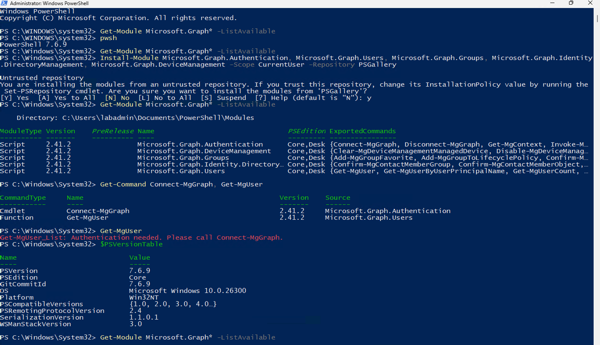
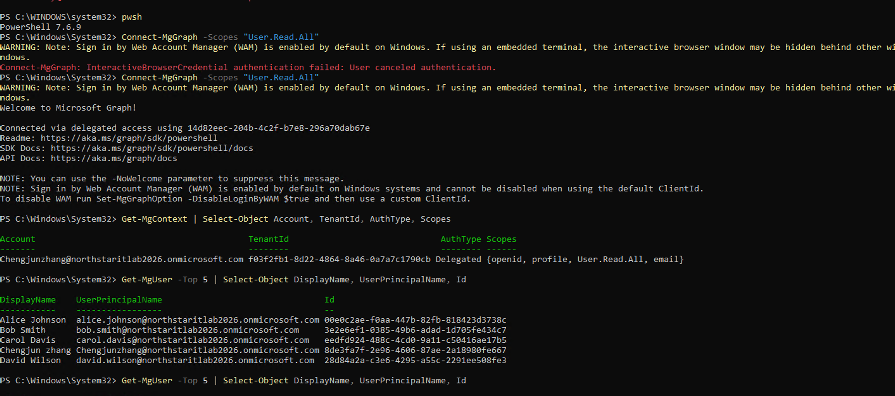
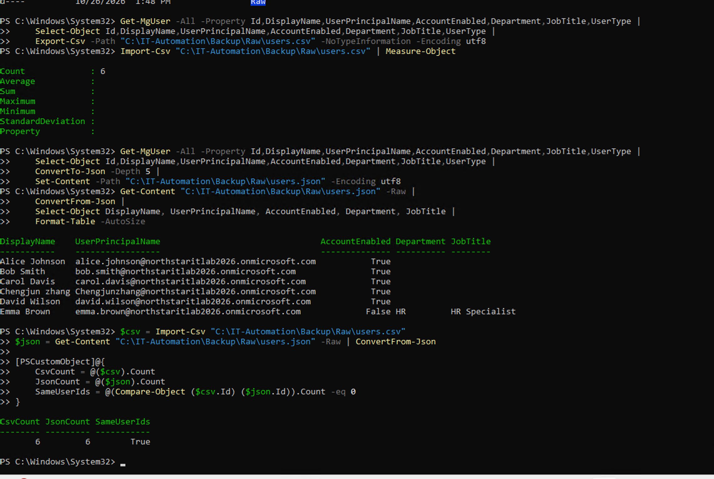
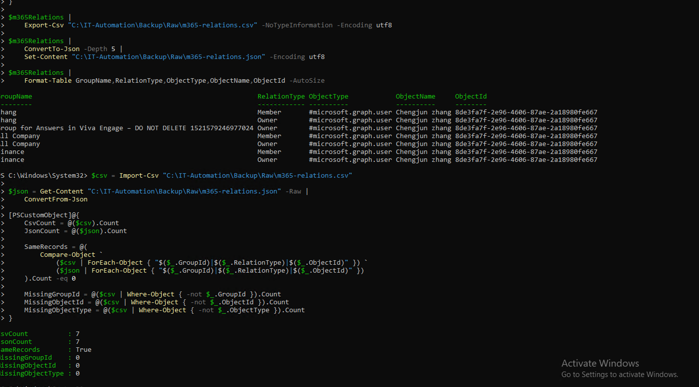
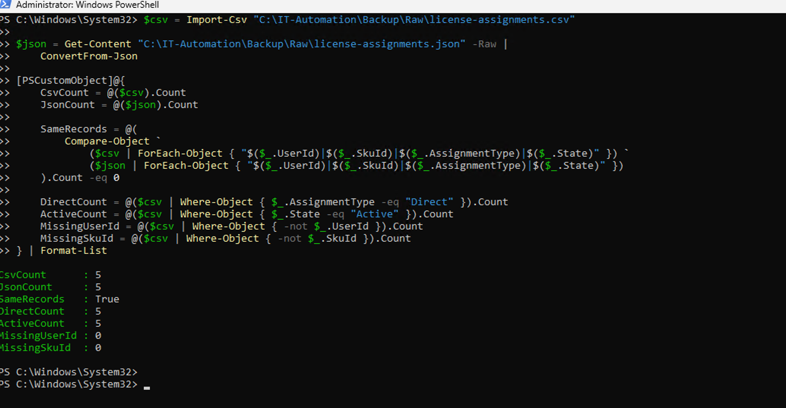
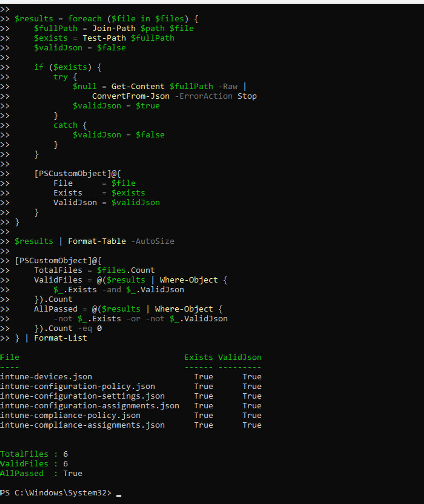
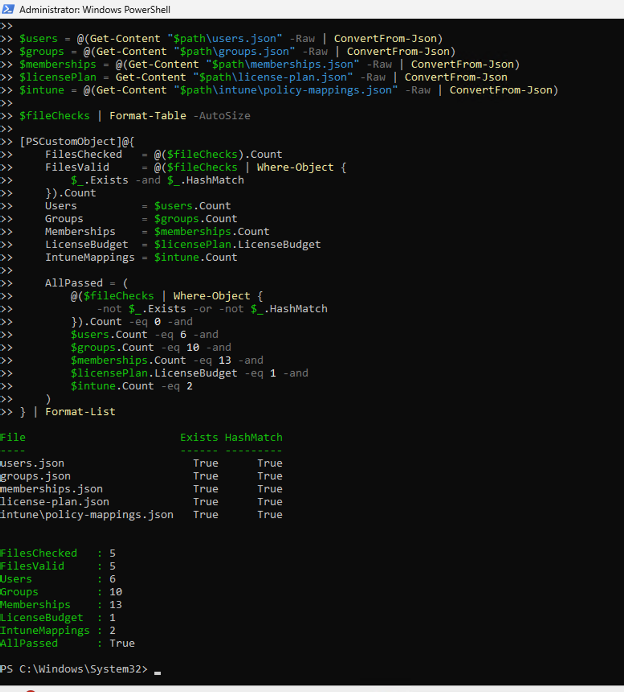
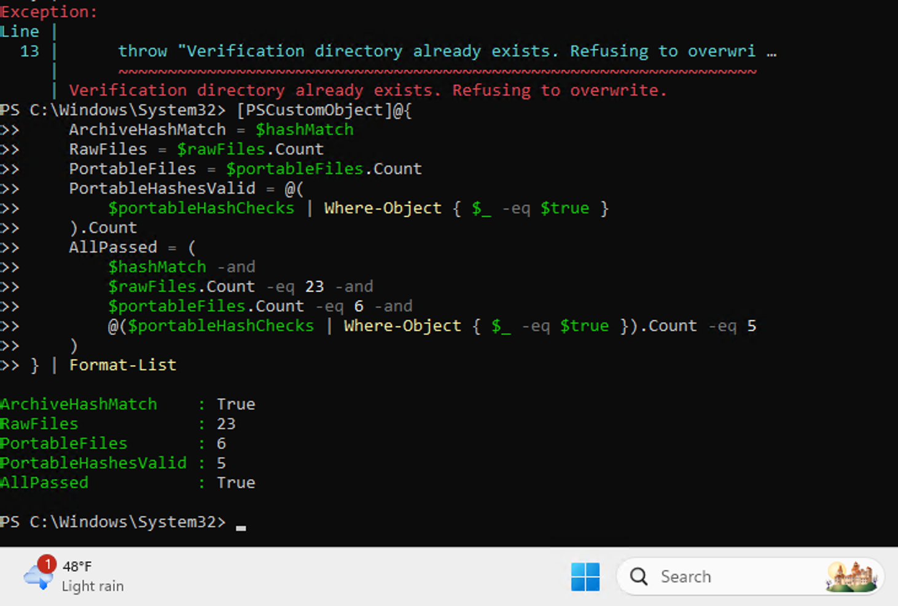

# **1. PowerShell Environment Preparation**

## **1. Objective**

Set up a PowerShell automation environment on CLIENT01, a Windows 11 virtual machine, to support future administration of Microsoft Entra ID, Microsoft 365, and Intune through Microsoft Graph.

The main objectives were to:

- Install and verify PowerShell 7.
- Install the Microsoft Graph PowerShell SDK.
- Verify the availability of essential administrative commands.

## **2. Environment**

| **Component**                  | **Configuration**              |
| ------------------------------ | ------------------------------ |
| Management Workstation         | CLIENT01                       |
| Operating System               | Windows 11 Pro                 |
| Virtualization                 | Hyper-V                        |
| PowerShell                     | 7.6.9                          |
| Microsoft Graph PowerShell SDK | 2.41.2                         |
| Module Repository              | PowerShell Gallery (PSGallery) |

## **3. Implementation**

### **3.1 PowerShell Installation**

Checked the existing PowerShell version:

```powershell
$PSVersionTable
```

The system was running Windows PowerShell 5.1.

PowerShell 7 was selected as the primary automation environment for its modern architecture, ongoing development, and cross-platform compatibility.

Installed PowerShell 7.6.9 using Windows Package Manager (winget).

Launched PowerShell 7:

```powershell
pwsh
```

Verified the installation:

```powershell
$PSVersionTable
```

Output:

```text
PSVersion    7.6.9
PSEdition    Core
```

PowerShell 7 was successfully installed alongside Windows PowerShell 5.1.

### **3.2 Microsoft Graph PowerShell SDK Installation**

Microsoft Graph is a REST API that provides access to Microsoft cloud services, including Entra ID, Microsoft 365, and Intune.

The Microsoft Graph PowerShell SDK exposes these API operations through PowerShell commands, enabling automated cloud administration.

Checked for existing Microsoft Graph modules:

```powershell
Get-Module Microsoft.Graph* -ListAvailable
```

No modules were found.

Installed the required modules:

```powershell
Install-Module Microsoft.Graph.Authentication, Microsoft.Graph.Users, Microsoft.Graph.Groups, Microsoft.Graph.Identity.DirectoryManagement, Microsoft.Graph.DeviceManagement -Scope CurrentUser -Repository PSGallery
```

The selected modules provide capabilities for:

- Microsoft Graph authentication.
- Entra ID user management.
- Security group and membership management.
- Directory and license management.
- Intune device management.

All modules were installed under the current Windows user’s PowerShell module directory.

## **4. Verification**

### **4.1 Module Verification**

Executed:

```powershell
Get-Module Microsoft.Graph* -ListAvailable
```

Confirmed the installation of the following modules:

| **Module**                                   | **Version** |
| -------------------------------------------- | ----------- |
| Microsoft.Graph.Authentication               | 2.41.2      |
| Microsoft.Graph.Users                        | 2.41.2      |
| Microsoft.Graph.Groups                       | 2.41.2      |
| Microsoft.Graph.Identity.DirectoryManagement | 2.41.2      |
| Microsoft.Graph.DeviceManagement             | 2.41.2      |

### **4.2 Command Verification**

Executed:

```powershell
Get-Command Connect-MgGraph, Get-MgUser
```

Output:

```text
CommandType  Name             Version  Source
-----------  ----             -------  ------
Cmdlet       Connect-MgGraph  2.41.2   Microsoft.Graph.Authentication
Function     Get-MgUser       2.41.2   Microsoft.Graph.Users
```

Both commands were successfully recognized.

Attempted to query Entra ID users:

```powershell
Get-MgUser
```

The command returned:

```text
Get-MgUser_List: Authentication needed.
Please call Connect-MgGraph.
```

This was expected because the Microsoft Graph PowerShell SDK was installed, but an authenticated Microsoft Graph session had not yet been established.

Authentication, permission scopes, and actual cloud queries will be addressed in the next chapter.

## **5. Result**

Successfully configured CLIENT01 as a PowerShell automation workstation.

**Completed tasks:**

1. Installed and verified PowerShell 7.6.9.
2. Installed five Microsoft Graph PowerShell SDK modules.
3. Verified module installation and versions.
4. Confirmed the availability of `Connect-MgGraph` and `Get-MgUser`.

**Final Status: Completed — PowerShell Environment Ready**

The next chapter will establish an authenticated connection to the Microsoft 365 test tenant, verify Microsoft Graph permissions, and perform initial Entra ID user queries.




# **2.Microsoft Graph Authentication**

## **2.1 Connect to Microsoft Graph**

Established a connection to Tenant A using delegated authentication:

```powershell
Connect-MgGraph -Scopes "User.Read.All"
```

Requested **User.Read.All** to read organizational user profiles, following the principle of least privilege.

## **2.2 Verify Authentication and Permissions**

Verified the connected account, tenant ID, authentication type, and granted permissions:

```powershell
Get-MgContext | Select-Object Account, TenantId, AuthType, Scopes
```

**Verification results:**

- Connected to the intended Tenant A administrator account.
- Authentication type: Delegated.
- Granted scopes included User.Read.All.

## **2.3 Test Entra ID User Access**

Retrieved five Entra ID users to verify actual Microsoft Graph API access:

```powershell
Get-MgUser -Top 5 | Select-Object DisplayName, UserPrincipalName, Id
```

Successfully retrieved five users, including their display names, user principal names, and object IDs.

## **2.4 Result**

Successfully established and verified delegated Microsoft Graph access to Tenant A.

Confirmed that the authenticated session could retrieve Entra ID user information using the requested read permission.

**Status: Completed — Microsoft Graph Authentication Verified**





# **3.Entra ID Users Export**

Exported Entra ID user configurations from Tenant A to local CSV and JSON files for backup and future cross-tenant deployment.

## **3.1 Create Backup Directory**

Created a directory to store the exported configuration files.

```powershell
New-Item -ItemType Directory -Path "C:\IT-Automation\Backup\Raw" -Force
```

## **3.2 Export Users to CSV**

```powershell
Get-MgUser -All -Property Id,DisplayName,UserPrincipalName,AccountEnabled,Department,JobTitle,UserType |
    Select-Object Id,DisplayName,UserPrincipalName,AccountEnabled,Department,JobTitle,UserType |
    Export-Csv -Path "C:\IT-Automation\Backup\Raw\users.csv" -NoTypeInformation -Encoding utf8
```

Retrieved all Entra ID users with seven selected attributes and exported them to CSV. The **-All** parameter handles pagination, ensuring all user records are retrieved.

## **3.3 Export Users to JSON**

```powershell
Get-MgUser -All -Property Id,DisplayName,UserPrincipalName,AccountEnabled,Department,JobTitle,UserType |
    Select-Object Id,DisplayName,UserPrincipalName,AccountEnabled,Department,JobTitle,UserType |
    ConvertTo-Json -Depth 5 |
    Set-Content -Path "C:\IT-Automation\Backup\Raw\users.json" -Encoding utf8
```

Exported the same user attributes to JSON for structured configuration processing. **-Depth 5** provides sufficient serialization depth for the selected attributes.

## **3.4 Validate Exported Files**

Read the exported CSV file and verified its record count:

```powershell
Import-Csv "C:\IT-Automation\Backup\Raw\users.csv" | Measure-Object
```

Read the JSON file and inspected the user attributes:

```powershell
Get-Content "C:\IT-Automation\Backup\Raw\users.json" -Raw |
    ConvertFrom-Json |
    Select-Object DisplayName, UserPrincipalName, AccountEnabled, Department, JobTitle |
    Format-Table -AutoSize
```

Both files were successfully read and contained six user records.

Finally, compared the record counts and user Object IDs between the two files:

```powershell
$csv = Import-Csv "C:\IT-Automation\Backup\Raw\users.csv"
$json = Get-Content "C:\IT-Automation\Backup\Raw\users.json" -Raw | ConvertFrom-Json

[PSCustomObject]@{
    CsvCount = @($csv).Count
    JsonCount = @($json).Count
    SameUserIds = @(Compare-Object ($csv.Id) ($json.Id)).Count -eq 0
}
```

**Validation result:**

```text
CsvCount JsonCount SameUserIds
-------- --------- -----------
       6         6        True
```

## **3.5 Result**

Successfully exported all six Entra ID users and their seven selected attributes to CSV and JSON.

Both files passed readability, record count, and user Object ID consistency checks.

The exported files are preserved as raw configuration snapshots for future cross-tenant reconstruction.

**Status: Completed — Entra ID Users Export Verified**




# **4.Entra ID Groups & Membership Export**

Exported security groups, Microsoft 365 groups, and their membership relationships from Tenant A using Microsoft Graph PowerShell.

## **4.1 Export Security Groups**

Retrieved all security groups and exported their configurations to CSV and JSON.

```powershell
$groups = Get-MgGroup -All -Filter "securityEnabled eq true" `
    -Property Id,DisplayName,Description,SecurityEnabled,MailEnabled,GroupTypes,MembershipRule,MembershipRuleProcessingState

$groups |
    Select-Object Id,DisplayName,Description,SecurityEnabled,MailEnabled,GroupTypes,MembershipRule,MembershipRuleProcessingState |
    Export-Csv "C:\IT-Automation\Backup\Raw\groups.csv" -NoTypeInformation -Encoding utf8

$groups |
    Select-Object Id,DisplayName,Description,SecurityEnabled,MailEnabled,GroupTypes,MembershipRule,MembershipRuleProcessingState |
    ConvertTo-Json -Depth 5 |
    Set-Content "C:\IT-Automation\Backup\Raw\groups.json" -Encoding utf8
```

**Result:** 6 security groups exported.

## **4.2 Export Security Group Memberships**

Retrieved direct group members, including users and devices.

```powershell
$memberships = foreach ($group in $groups) {
    $members = Get-MgGroupMember -GroupId $group.Id -All

    foreach ($member in $members) {
        [PSCustomObject]@{
            GroupName         = $group.DisplayName
            GroupId           = $group.Id
            MemberId          = $member.Id
            MemberType        = $member.AdditionalProperties['@odata.type']
            MemberName        = $member.AdditionalProperties['displayName']
            UserPrincipalName = $member.AdditionalProperties['userPrincipalName']
        }
    }
}

$memberships |
    Export-Csv "C:\IT-Automation\Backup\Raw\memberships.csv" -NoTypeInformation -Encoding utf8

$memberships |
    ConvertTo-Json -Depth 5 |
    Set-Content "C:\IT-Automation\Backup\Raw\memberships.json" -Encoding utf8
```

A device member initially had no display name. Retrieved its details using Microsoft Graph and updated both backup files.

```powershell
$device = Get-MgDevice -DeviceId "6c5e77c6-ae73-482e-bc90-5b5e4375634b"

$memberships = Import-Csv "C:\IT-Automation\Backup\Raw\memberships.csv"

$memberships |
    Where-Object { $_.MemberId -eq $device.Id } |
    ForEach-Object { $_.MemberName = $device.DisplayName }

$memberships |
    Export-Csv "C:\IT-Automation\Backup\Raw\memberships.csv" -NoTypeInformation -Encoding utf8

$memberships |
    ConvertTo-Json -Depth 5 |
    Set-Content "C:\IT-Automation\Backup\Raw\memberships.json" -Encoding utf8
```

**Result:** 6 membership records exported: 5 user memberships and 1 device membership (CLIENT02).

## **4.3 Export Microsoft 365 Groups**

```powershell
$m365Groups = Get-MgGroup -All -Filter "groupTypes/any(c:c eq 'Unified')" `
    -Property Id,DisplayName,Description,Mail,MailNickname,Visibility,SecurityEnabled,MailEnabled,GroupTypes

$m365Groups |
    Select-Object Id,DisplayName,Description,Mail,MailNickname,Visibility,SecurityEnabled,MailEnabled,GroupTypes |
    Export-Csv "C:\IT-Automation\Backup\Raw\m365-groups.csv" -NoTypeInformation -Encoding utf8

$m365Groups |
    Select-Object Id,DisplayName,Description,Mail,MailNickname,Visibility,SecurityEnabled,MailEnabled,GroupTypes |
    ConvertTo-Json -Depth 5 |
    Set-Content "C:\IT-Automation\Backup\Raw\m365-groups.json" -Encoding utf8
```

**Result:** 4 Microsoft 365 groups exported.

## **4.4 Export Microsoft 365 Group Members and Owners**

```powershell
$m365Relations = foreach ($group in $m365Groups) {

    foreach ($member in (Get-MgGroupMember -GroupId $group.Id -All)) {
        [PSCustomObject]@{
            GroupName    = $group.DisplayName
            GroupId      = $group.Id
            RelationType = "Member"
            ObjectId     = $member.Id
            ObjectType   = $member.AdditionalProperties['@odata.type']
            ObjectName   = $member.AdditionalProperties['displayName']
        }
    }

    foreach ($owner in (Get-MgGroupOwner -GroupId $group.Id -All)) {
        [PSCustomObject]@{
            GroupName    = $group.DisplayName
            GroupId      = $group.Id
            RelationType = "Owner"
            ObjectId     = $owner.Id
            ObjectType   = $owner.AdditionalProperties['@odata.type']
            ObjectName   = $owner.AdditionalProperties['displayName']
        }
    }
}

$m365Relations |
    Export-Csv "C:\IT-Automation\Backup\Raw\m365-relations.csv" -NoTypeInformation -Encoding utf8

$m365Relations |
    ConvertTo-Json -Depth 5 |
    Set-Content "C:\IT-Automation\Backup\Raw\m365-relations.json" -Encoding utf8
```

**Result:** 7 relationships exported: 3 member relationships and 4 owner relationships.

## **4.5 Backup Validation**

Imported CSV and JSON files and compared their record counts, relationship identifiers, and required fields using PowerShell.

**Security Group Memberships**

- CSV records: 6
- JSON records: 6
- Matching relationship identifiers: True
- Missing group IDs: 0
- Missing member IDs: 0
- Missing member names: 0

**Microsoft 365 Group Relationships**

- CSV records: 7
- JSON records: 7
- Matching relationship identifiers: True
- Missing group IDs: 0
- Missing object IDs: 0
- Missing object types: 0

## **4.6 Result**

Successfully exported:

- 6 security groups and 6 direct membership relationships.
- 4 Microsoft 365 groups and 7 member/owner relationships.
- 8 backup files in CSV and JSON formats.

**Troubleshooting:** Encountered HTTP 403 when querying Entra ID devices. Added the delegated Microsoft Graph permission **Device.Read.All** and successfully retrieved the device information.

**Scope:** This backup covers basic group properties and direct membership/ownership relationships. It does not include associated Teams, SharePoint content, or other Microsoft 365 workloads.




# **5.Microsoft 365 License Export**

## **5.1 Export Tenant License SKUs**

```powershell
$licenses = Get-MgSubscribedSku

$licenses |
    Select-Object SkuPartNumber,SkuId,CapabilityStatus,ConsumedUnits,PrepaidUnits,ServicePlans |
    Export-Csv "C:\IT-Automation\Backup\Raw\licenses.csv" -NoTypeInformation -Encoding utf8

$licenses |
    Select-Object SkuPartNumber,SkuId,CapabilityStatus,ConsumedUnits,PrepaidUnits,ServicePlans |
    ConvertTo-Json -Depth 10 |
    Set-Content "C:\IT-Automation\Backup\Raw\licenses.json" -Encoding utf8
```

**Result:** One Microsoft 365 Business Premium SKU (SPB), with 25 enabled seats and 5 consumed seats.

## **5.2 Export User License Assignments**

```powershell
$userLicenses = foreach ($user in (
    Get-MgUser -All -Property Id,DisplayName,UserPrincipalName,AssignedLicenses
)) {
    foreach ($license in $user.AssignedLicenses) {
        [PSCustomObject]@{
            UserId            = $user.Id
            DisplayName       = $user.DisplayName
            UserPrincipalName = $user.UserPrincipalName
            SkuId             = $license.SkuId
            DisabledPlans     = @($license.DisabledPlans)
        }
    }
}

$userLicenses |
    Export-Csv "C:\IT-Automation\Backup\Raw\user-licenses.csv" -NoTypeInformation -Encoding utf8

$userLicenses |
    ConvertTo-Json -Depth 10 |
    Set-Content "C:\IT-Automation\Backup\Raw\user-licenses.json" -Encoding utf8
```

**Result:** Five user-license assignments exported.

## **5.3 Export License Assignment Sources**

```powershell
$licenseAssignments = foreach ($user in (
    Get-MgUser -All -Property Id,DisplayName,UserPrincipalName,LicenseAssignmentStates
)) {
    foreach ($assignment in $user.LicenseAssignmentStates) {
        [PSCustomObject]@{
            UserId            = $user.Id
            UserPrincipalName = $user.UserPrincipalName
            DisplayName       = $user.DisplayName
            SkuId             = $assignment.SkuId
            AssignedByGroup   = $assignment.AssignedByGroup
            AssignmentType    = if ($assignment.AssignedByGroup) { "Group" } else { "Direct" }
            State             = $assignment.State
            Error             = $assignment.Error
        }
    }
}

$licenseAssignments |
    Export-Csv "C:\IT-Automation\Backup\Raw\license-assignments.csv" -NoTypeInformation -Encoding utf8

$licenseAssignments |
    ConvertTo-Json -Depth 5 |
    Set-Content "C:\IT-Automation\Backup\Raw\license-assignments.json" -Encoding utf8
```

**Result:** Five direct assignments, all in Active state. No group-based license assignments were found.

## **5.4 Backup Validation**

```
$csv = Import-Csv "C:\IT-Automation\Backup\Raw\license-assignments.csv"

$json = Get-Content "C:\IT-Automation\Backup\Raw\license-assignments.json" -Raw |
    ConvertFrom-Json

[PSCustomObject]@{
    CsvCount = @($csv).Count
    JsonCount = @($json).Count

    SameRecords = @(
        Compare-Object `
            ($csv | ForEach-Object { "$($_.UserId)|$($_.SkuId)|$($_.AssignmentType)|$($_.State)" }) `
            ($json | ForEach-Object { "$($_.UserId)|$($_.SkuId)|$($_.AssignmentType)|$($_.State)" })
    ).Count -eq 0

    DirectCount = @($csv | Where-Object { $_.AssignmentType -eq "Direct" }).Count
    ActiveCount = @($csv | Where-Object { $_.State -eq "Active" }).Count
    MissingUserId = @($csv | Where-Object { -not $_.UserId }).Count
    MissingSkuId = @($csv | Where-Object { -not $_.SkuId }).Count
} | Format-List
```




# **6. Intune Configuration Export**

## **6.1 Export Managed Devices**

Exported Intune-managed device information to CSV and JSON files using Microsoft Graph PowerShell.

```powershell
$devices = Get-MgDeviceManagementManagedDevice -All

$deviceInventory = $devices | Select-Object `
    Id,DeviceName,AzureADDeviceId,OperatingSystem,OSVersion,
    ComplianceState,ManagementAgent,EnrolledDateTime,
    LastSyncDateTime,UserPrincipalName

$deviceInventory |
    Export-Csv "C:\IT-Automation\Backup\Raw\intune-devices.csv" -NoTypeInformation -Encoding utf8

$deviceInventory |
    ConvertTo-Json -Depth 10 |
    Set-Content "C:\IT-Automation\Backup\Raw\intune-devices.json" -Encoding utf8
```

**Result:** Exported two Windows devices, CLIENT01 and CLIENT02. Both were reported as compliant.

## **6.2 Export Configuration Policy**

Retrieved the Intune configuration policy, its settings, and its group assignments through Microsoft Graph.

```powershell
$policyId = "442f2e53-9448-4be3-a441-0ebc55ba7cb9"
$path = "C:\IT-Automation\Backup\Raw"

$policy = Invoke-MgGraphRequest -Method GET `
    -Uri "https://graph.microsoft.com/beta/deviceManagement/configurationPolicies/$policyId"

$settings = Invoke-MgGraphRequest -Method GET `
    -Uri "https://graph.microsoft.com/beta/deviceManagement/configurationPolicies/$policyId/settings?`$top=100"

$assignments = Invoke-MgGraphRequest -Method GET `
    -Uri "https://graph.microsoft.com/beta/deviceManagement/configurationPolicies/$policyId/assignments"

$policy |
    ConvertTo-Json -Depth 50 |
    Set-Content "$path\intune-configuration-policy.json" -Encoding utf8

$settings |
    ConvertTo-Json -Depth 50 |
    Set-Content "$path\intune-configuration-settings.json" -Encoding utf8

$assignments |
    ConvertTo-Json -Depth 50 |
    Set-Content "$path\intune-configuration-assignments.json" -Encoding utf8
```

**Result:**

- Policy: CLIENT02 - Device Restrictions
- Configuration settings: 1
- Assignment target: Intune-Test-Users

## **6.3 Export Compliance Policy**

Exported the Windows compliance policy and its group assignments.

```powershell
$policyId = "08a93603-1d4e-4d0b-b939-c5353bef5f9d"
$path = "C:\IT-Automation\Backup\Raw"

$policy = Invoke-MgGraphRequest -Method GET `
    -Uri "https://graph.microsoft.com/v1.0/deviceManagement/deviceCompliancePolicies/$policyId"

$assignments = Invoke-MgGraphRequest -Method GET `
    -Uri "https://graph.microsoft.com/v1.0/deviceManagement/deviceCompliancePolicies/$policyId/assignments"

$policy |
    ConvertTo-Json -Depth 50 |
    Set-Content "$path\intune-compliance-policy.json" -Encoding utf8

$assignments |
    ConvertTo-Json -Depth 50 |
    Set-Content "$path\intune-compliance-assignments.json" -Encoding utf8
```

**Result:**

- Policy: CLIENT02 - Firewall Compliance
- Policy type: Windows Compliance Policy
- Assignment target: Intune-Test-Devices

## **6.4 Backup Validation**

Validated the exported device inventory, configuration policies, compliance policies, settings, assignments, and JSON files.

```powershell
$path = "C:\IT-Automation\Backup\Raw"

$files = @(
    "intune-devices.json",
    "intune-configuration-policy.json",
    "intune-configuration-settings.json",
    "intune-configuration-assignments.json",
    "intune-compliance-policy.json",
    "intune-compliance-assignments.json"
)

$results = foreach ($file in $files) {
    $fullPath = Join-Path $path $file
    $exists = Test-Path $fullPath
    $validJson = $false

    if ($exists) {
        try {
            $null = Get-Content $fullPath -Raw |
                ConvertFrom-Json -ErrorAction Stop
            $validJson = $true
        }
        catch {
            $validJson = $false
        }
    }

    [PSCustomObject]@{
        File      = $file
        Exists    = $exists
        ValidJson = $validJson
    }
}

$results | Format-Table -AutoSize

[PSCustomObject]@{
    TotalFiles = $files.Count
    ValidFiles = @($results | Where-Object {
        $_.Exists -and $_.ValidJson
    }).Count
    AllPassed = @($results | Where-Object {
        -not $_.Exists -or -not $_.ValidJson
    }).Count -eq 0
} | Format-List
```

**Validation results:**

| **Validation**                   | **Result** |
| -------------------------------- | ---------- |
| Managed devices                  | 2          |
| Device CSV/JSON IDs match        | True       |
| Configuration policies           | 1          |
| Configuration settings           | 1          |
| Configuration policy assignments | 1          |
| Compliance policies              | 1          |
| Compliance policy assignments    | 1          |
| Required JSON files              | 6          |
| Valid JSON files                 | 6          |
| AllPassed                        | True       |




# **7. Portable Configuration Package**

## **7.1 Create Portable Directory**

Created a separate directory for portable configuration files while preserving the original raw backups.

```powershell
$portablePath = "C:\IT-Automation\Backup\Portable"

New-Item -ItemType Directory -Path $portablePath -Force
New-Item -ItemType Directory -Path "$portablePath\intune" -Force
```

## **7.2 Generate Portable Users**

Converted exported Entra ID users into portable configuration records, retaining source IDs for reference while separating usernames from the source tenant domain.

```powershell
$rawPath = "C:\IT-Automation\Backup\Raw"
$portablePath = "C:\IT-Automation\Backup\Portable"

$users = Import-Csv "$rawPath\users.csv"

$portableUsers = foreach ($user in $users) {

    $username = ($user.UserPrincipalName -split "@")[0]

    [PSCustomObject]@{
        SourceUserId   = $user.Id
        SourceUPN      = $user.UserPrincipalName
        Username       = $username
        DisplayName    = $user.DisplayName
        Department     = $user.Department
        JobTitle       = $user.JobTitle
        UserType       = $user.UserType
        AccountEnabled = [System.Convert]::ToBoolean($user.AccountEnabled)
    }
}

$portableUsers |
    ConvertTo-Json -Depth 10 |
    Set-Content "$portablePath\users.json" -Encoding utf8
```

**Result:** 6 user records, including 5 enabled accounts and 1 disabled account.

## **7.3 Generate Portable Groups**

Combined Security Groups and Microsoft 365 Groups into a single portable configuration file.

```powershell
$securityGroups = Import-Csv "$rawPath\groups.csv"
$m365Groups = Import-Csv "$rawPath\m365-groups.csv"

$portableGroups = @(
    foreach ($group in $securityGroups) {
        [PSCustomObject]@{
            SourceGroupId  = $group.Id
            DisplayName    = $group.DisplayName
            GroupType      = "Security"
            Description    = $group.Description
            MailNickname   = $null
            Visibility     = $null
            MembershipRule = $group.MembershipRule
        }
    }

    foreach ($group in $m365Groups) {
        [PSCustomObject]@{
            SourceGroupId  = $group.Id
            DisplayName    = $group.DisplayName
            GroupType      = "Microsoft365"
            Description    = $group.Description
            MailNickname   = $group.MailNickname
            Visibility     = $group.Visibility
            MembershipRule = $null
        }
    }
)

$portableGroups |
    ConvertTo-Json -Depth 10 |
    Set-Content "$portablePath\groups.json" -Encoding utf8
```

**Result:** 10 groups exported: 6 Security Groups and 4 Microsoft 365 Groups.

## **7.4 Generate Portable Memberships**

Converted group membership and ownership relationships into portable records containing source IDs and reusable member identifiers.

```powershell
$securityMembers = Import-Csv "$rawPath\memberships.csv"
$m365Relations = Import-Csv "$rawPath\m365-relations.csv"

$portableMemberships = @(
    foreach ($item in $securityMembers) {

        $username = if ($item.UserPrincipalName) {
            ($item.UserPrincipalName -split "@")[0]
        } else {
            $null
        }

        [PSCustomObject]@{
            SourceGroupId  = $item.GroupId
            GroupName      = $item.GroupName
            RelationType   = "Member"
            SourceMemberId = $item.MemberId
            MemberType     = $item.MemberType
            MemberName     = $item.MemberName
            MemberUsername = $username
        }
    }

    foreach ($item in $m365Relations) {

        $sourceUser = $portableUsers |
            Where-Object { $_.SourceUserId -eq $item.ObjectId } |
            Select-Object -First 1

        [PSCustomObject]@{
            SourceGroupId  = $item.GroupId
            GroupName      = $item.GroupName
            RelationType   = $item.RelationType
            SourceMemberId = $item.ObjectId
            MemberType     = $item.ObjectType
            MemberName     = $item.ObjectName
            MemberUsername = if ($sourceUser) {
                $sourceUser.Username
            } else {
                $null
            }
        }
    }
)

$portableMemberships |
    ConvertTo-Json -Depth 10 |
    Set-Content "$portablePath\memberships.json" -Encoding utf8
```

**Result:** 13 membership and ownership relationships, including one device membership.

## **7.5 Generate Portable License Plan**

Created a destination license allocation plan designed for a tenant with only one Microsoft 365 Business Premium license.

```powershell
$sourceAssignments = Import-Csv "$rawPath\license-assignments.csv"

$licensePlan = [PSCustomObject]@{
    SourceSkuPartNumber = "SPB"
    SourceSkuId         = "cbdc14ab-d96c-4c30-b9f4-6ada7cdc1d46"
    DestinationSku      = "SPB"
    LicenseBudget       = 1
    AssignmentMode      = "Direct"

    PlannedAssignments = @(
        [PSCustomObject]@{
            Username = "Chengjunzhang"
            Assign   = $true
        }
    )

    SourceAssignments = @(
        foreach ($assignment in $sourceAssignments) {
            [PSCustomObject]@{
                Username = ($assignment.UserPrincipalName -split "@")[0]
                SkuId    = $assignment.SkuId
                State    = $assignment.State
            }
        }
    )
}

$licensePlan |
    ConvertTo-Json -Depth 10 |
    Set-Content "$portablePath\license-plan.json" -Encoding utf8
```

**Result:** Preserved 5 source assignments and planned 1 destination assignment.

## **7.6 Generate Portable Intune Policy Mappings**

Mapped exported Intune configuration and compliance policies to their corresponding Security Groups.

```powershell
$groups = @(
    Get-Content "$portablePath\groups.json" -Raw |
        ConvertFrom-Json
)

$policies = @(
    [PSCustomObject]@{
        PolicyType      = "Configuration"
        PolicyFile      = "intune-configuration-policy.json"
        AssignmentsFile = "intune-configuration-assignments.json"
    }

    [PSCustomObject]@{
        PolicyType      = "Compliance"
        PolicyFile      = "intune-compliance-policy.json"
        AssignmentsFile = "intune-compliance-assignments.json"
    }
)

$portableIntune = foreach ($item in $policies) {

    $policy = Get-Content "$rawPath\$($item.PolicyFile)" -Raw |
        ConvertFrom-Json

    $assignments = Get-Content "$rawPath\$($item.AssignmentsFile)" -Raw |
        ConvertFrom-Json

    foreach ($assignment in $assignments.value) {

        $sourceGroupId = $assignment.target.groupId

        $targetGroup = $groups |
            Where-Object { $_.SourceGroupId -eq $sourceGroupId } |
            Select-Object -First 1

        [PSCustomObject]@{
            PolicyType         = $item.PolicyType
            PolicyName         = if ($policy.name) {
                $policy.name
            } else {
                $policy.displayName
            }
            SourcePolicyId     = $policy.id
            SourceGroupId      = $sourceGroupId
            TargetGroupName    = $targetGroup.DisplayName
            TargetGroupType    = $targetGroup.GroupType
            RequiresNewGroupId = $true
            RequiresValidation = $true
        }
    }
}

$portableIntune |
    ConvertTo-Json -Depth 10 |
    Set-Content "$portablePath\intune\policy-mappings.json" -Encoding utf8
```

**Result:** 2 policy mappings with no unresolved target groups.

## **7.7 Generate Package Manifest**

Created a manifest containing the source tenant information, package metadata, file sizes, and SHA256 checksums.

```powershell
$fileList = @(
    "users.json",
    "groups.json",
    "memberships.json",
    "license-plan.json",
    "intune\policy-mappings.json"
)

$fileRecords = foreach ($file in $fileList) {

    $fullPath = Join-Path $portablePath $file

    if (-not (Test-Path $fullPath)) {
        throw "Missing file: $fullPath"
    }

    $data = Get-Content $fullPath -Raw |
        ConvertFrom-Json -ErrorAction Stop

    [PSCustomObject]@{
        File      = $file
        SizeBytes = (Get-Item $fullPath).Length
        SHA256    = (Get-FileHash $fullPath -Algorithm SHA256).Hash
    }
}

$manifest = [PSCustomObject]@{
    PackageName        = "Northstar-Cloud-Configuration"
    SourceTenantId     = "f03f2fb1-8d22-4864-8a46-0a7a7c1790cb"
    SourceTenantDomain = "northstaritlab2026.onmicrosoft.com"
    CreatedAt          = (Get-Date).ToString("o")
    PackageVersion     = "1.0"
    Files              = $fileRecords
}

$manifest |
    ConvertTo-Json -Depth 10 |
    Set-Content "$portablePath\manifest.json" -Encoding utf8
```

## **7.8 Backup Validation**

Verified the five portable configuration files against their SHA256 checksums and checked the expected configuration record counts.

```powershell
$path = "C:\IT-Automation\Backup\Portable"

$manifest = Get-Content "$path\manifest.json" -Raw |
    ConvertFrom-Json

$fileChecks = foreach ($file in $manifest.Files) {

    $fullPath = Join-Path $path $file.File
    $exists = Test-Path $fullPath

    $hashMatch = $false

    if ($exists) {
        $actualHash = (Get-FileHash $fullPath -Algorithm SHA256).Hash
        $hashMatch = $actualHash -eq $file.SHA256
    }

    [PSCustomObject]@{
        File      = $file.File
        Exists    = $exists
        HashMatch = $hashMatch
    }
}

$users = @(Get-Content "$path\users.json" -Raw | ConvertFrom-Json)
$groups = @(Get-Content "$path\groups.json" -Raw | ConvertFrom-Json)
$memberships = @(Get-Content "$path\memberships.json" -Raw | ConvertFrom-Json)
$licensePlan = Get-Content "$path\license-plan.json" -Raw | ConvertFrom-Json
$intune = @(Get-Content "$path\intune\policy-mappings.json" -Raw | ConvertFrom-Json)

$fileChecks | Format-Table -AutoSize

[PSCustomObject]@{
    FilesChecked   = @($fileChecks).Count
    FilesValid     = @($fileChecks | Where-Object {
        $_.Exists -and $_.HashMatch
    }).Count
    Users          = $users.Count
    Groups         = $groups.Count
    Memberships    = $memberships.Count
    LicenseBudget  = $licensePlan.LicenseBudget
    IntuneMappings = $intune.Count

    AllPassed = (
        @($fileChecks | Where-Object {
            -not $_.Exists -or -not $_.HashMatch
        }).Count -eq 0 -and
        $users.Count -eq 6 -and
        $groups.Count -eq 10 -and
        $memberships.Count -eq 13 -and
        $licensePlan.LicenseBudget -eq 1 -and
        $intune.Count -eq 2
    )
} | Format-List
```




# **8. Backup Validation & Final Review**

## **8.1 Raw Backup Inventory**

Verified that all expected raw backup files were present before performing data integrity checks.

```powershell
$rawPath = "C:\IT-Automation\Backup\Raw"

$expectedFiles = @(
    "users.csv",
    "users.json",

    "groups.csv",
    "groups.json",
    "memberships.csv",
    "memberships.json",
    "m365-groups.csv",
    "m365-groups.json",
    "m365-relations.csv",
    "m365-relations.json",

    "licenses.csv",
    "licenses.json",
    "user-licenses.csv",
    "user-licenses.json",
    "license-assignments.csv",
    "license-assignments.json",

    "intune-devices.csv",
    "intune-devices.json",
    "intune-configuration-policy.json",
    "intune-configuration-settings.json",
    "intune-configuration-assignments.json",
    "intune-compliance-policy.json",
    "intune-compliance-assignments.json"
)

$results = foreach ($file in $expectedFiles) {

    $fullPath = Join-Path $rawPath $file

    [PSCustomObject]@{
        File   = $file
        Exists = Test-Path $fullPath
    }
}

$results | Format-Table -AutoSize

[PSCustomObject]@{
    ExpectedFiles = $expectedFiles.Count

    ExistingFiles = @(
        $results | Where-Object { $_.Exists }
    ).Count

    MissingFiles = @(
        $results | Where-Object { -not $_.Exists }
    ).Count

    AllPresent = @(
        $results | Where-Object { -not $_.Exists }
    ).Count -eq 0

} | Format-List
```

**Verified:** 23 expected files, 23 existing files, 0 missing files.

## **8.2 Raw Backup File Validation**

Checked that all raw backup files were non-empty and could be parsed as CSV or JSON.

```powershell
$rawPath = "C:\IT-Automation\Backup\Raw"

$files = Get-ChildItem $rawPath -File |
    Where-Object { $_.Extension -in ".csv", ".json" }

$validation = foreach ($file in $files) {

    $valid = $false
    $errorMessage = ""

    try {
        if ($file.Length -eq 0) {
            throw "Empty file"
        }

        if ($file.Extension -eq ".csv") {
            $data = @(Import-Csv $file.FullName -ErrorAction Stop)

            if ($data.Count -eq 0) {
                throw "No CSV records"
            }
        }
        elseif ($file.Extension -eq ".json") {
            $data = Get-Content $file.FullName -Raw |
                ConvertFrom-Json -ErrorAction Stop

            if ($null -eq $data) {
                throw "Empty JSON content"
            }
        }

        $valid = $true
    }
    catch {
        $errorMessage = $_.Exception.Message
    }

    [PSCustomObject]@{
        File  = $file.Name
        Valid = $valid
        Error = $errorMessage
    }
}

$validation | Format-Table -AutoSize

[PSCustomObject]@{
    FilesChecked = @($validation).Count

    ValidFiles = @(
        $validation | Where-Object { $_.Valid }
    ).Count

    InvalidFiles = @(
        $validation | Where-Object { -not $_.Valid }
    ).Count

    AllPassed = @(
        $validation | Where-Object { -not $_.Valid }
    ).Count -eq 0
} | Format-List
```

**Verified:** 23 files checked, 23 valid, 0 invalid.

## **8.3 Cross-File Consistency Validation**

Validated critical relationships between exported Entra ID users, groups, memberships, license assignments, and Intune policy targets.

```powershell
$raw = "C:\IT-Automation\Backup\Raw"

$users = @(Import-Csv "$raw\users.csv")
$usersJson = @(Get-Content "$raw\users.json" -Raw | ConvertFrom-Json)

$groups = @(Import-Csv "$raw\groups.csv")
$groupsJson = @(Get-Content "$raw\groups.json" -Raw | ConvertFrom-Json)

$m365Groups = @(Import-Csv "$raw\m365-groups.csv")
$m365GroupsJson = @(Get-Content "$raw\m365-groups.json" -Raw | ConvertFrom-Json)

$memberships = @(Import-Csv "$raw\memberships.csv")
$m365Relations = @(Import-Csv "$raw\m365-relations.csv")

$licenses = @(Import-Csv "$raw\licenses.csv")
$assignments = @(Import-Csv "$raw\license-assignments.csv")

$devices = @(Import-Csv "$raw\intune-devices.csv")

$configurationAssignments = Get-Content "$raw\intune-configuration-assignments.json" -Raw |
    ConvertFrom-Json

$complianceAssignments = Get-Content "$raw\intune-compliance-assignments.json" -Raw |
    ConvertFrom-Json

function Test-IdSet {
    param($Left, $Right)

    $a = @($Left | Sort-Object -Unique)
    $b = @($Right | Sort-Object -Unique)

    return (
        $a.Count -eq $b.Count -and
        @(Compare-Object $a $b).Count -eq 0
    )
}

$userIds = @($users.Id)
$groupIds = @($groups.Id) + @($m365Groups.Id)
$skuIds = @($licenses.SkuId)

$allRelations = @(
    foreach ($item in $memberships) {
        [PSCustomObject]@{
            GroupId    = $item.GroupId
            MemberId   = $item.MemberId
            MemberType = $item.MemberType
        }
    }

    foreach ($item in $m365Relations) {
        [PSCustomObject]@{
            GroupId    = $item.GroupId
            MemberId   = $item.ObjectId
            MemberType = $item.ObjectType
        }
    }
)

$checks = [ordered]@{
    UsersMatch = Test-IdSet $users.Id $usersJson.Id

    SecurityGroupsMatch = Test-IdSet $groups.Id $groupsJson.Id

    M365GroupsMatch = Test-IdSet $m365Groups.Id $m365GroupsJson.Id

    MembershipGroupsValid = @(
        $allRelations | Where-Object {
            $_.GroupId -notin $groupIds
        }
    ).Count -eq 0

    MembershipUsersValid = @(
        $allRelations | Where-Object {
            $_.MemberType -eq "#microsoft.graph.user" -and
            $_.MemberId -notin $userIds
        }
    ).Count -eq 0

    LicenseUsersValid = @(
        $assignments | Where-Object {
            $_.UserId -notin $userIds
        }
    ).Count -eq 0

    LicenseSkuValid = @(
        $assignments | Where-Object {
            $_.SkuId -notin $skuIds
        }
    ).Count -eq 0

    IntuneTargetsValid = @(
        @($configurationAssignments.value) +
        @($complianceAssignments.value) |
        Where-Object {
            $_.target.groupId -notin $groupIds
        }
    ).Count -eq 0
}

$checks.GetEnumerator() |
    ForEach-Object {
        [PSCustomObject]@{
            Check  = $_.Key
            Passed = $_.Value
        }
    } |
    Format-Table -AutoSize

[PSCustomObject]@{
    TotalChecks  = $checks.Count
    PassedChecks = @($checks.Values | Where-Object { $_ -eq $true }).Count
    FailedChecks = @($checks.Values | Where-Object { $_ -ne $true }).Count
    AllPassed    = @($checks.Values | Where-Object { $_ -ne $true }).Count -eq 0
} | Format-List
```

**Verified:** 8 consistency checks passed, 0 failed.

The checks confirmed that key user, group, license, and Intune policy references were consistent across the exported records.

## **8.4 Final Backup Archive**

Created a compressed ZIP archive containing both the original raw backups and the portable configuration package.

Generated a separate SHA256 checksum file to support future archive integrity verification.

```powershell
$backupRoot = "C:\IT-Automation\Backup"
$archivePath = "C:\IT-Automation\Northstar-Cloud-Backup.zip"
$hashPath = "C:\IT-Automation\Northstar-Cloud-Backup.sha256.txt"

if (Test-Path $archivePath) {
    throw "Archive already exists. Refusing to overwrite: $archivePath"
}

Compress-Archive `
    -Path "$backupRoot\Raw", "$backupRoot\Portable" `
    -DestinationPath $archivePath `
    -CompressionLevel Optimal `
    -ErrorAction Stop

$archiveHash = Get-FileHash $archivePath -Algorithm SHA256

$archiveHash.Hash |
    Set-Content $hashPath -Encoding utf8

[PSCustomObject]@{
    ArchiveExists  = Test-Path $archivePath
    HashFileExists = Test-Path $hashPath
    ArchiveSizeMB  = [math]::Round(
        (Get-Item $archivePath).Length / 1MB, 2
    )
    SHA256 = $archiveHash.Hash
} | Format-List
```

**Verified:** The ZIP archive and its SHA256 checksum file were created successfully.

## **8.5 Final Backup Verification**

Verified the archived backup by checking its SHA256 checksum, extracting it into a separate verification directory, counting the extracted files, and validating the portable configuration files against their manifest.

```powershell
$archivePath = "C:\IT-Automation\Northstar-Cloud-Backup.zip"
$hashPath = "C:\IT-Automation\Northstar-Cloud-Backup.sha256.txt"
$testPath = "C:\IT-Automation\Backup-Verification"

# Verify archive checksum
$expectedHash = (Get-Content $hashPath -Raw).Trim()
$actualHash = (Get-FileHash $archivePath -Algorithm SHA256).Hash

$hashMatch = $expectedHash -eq $actualHash

# Extract into a new verification directory
if (Test-Path $testPath) {
    throw "Verification directory already exists. Refusing to overwrite."
}

Expand-Archive `
    -Path $archivePath `
    -DestinationPath $testPath `
    -ErrorAction Stop

# Check extracted files
$rawFiles = @(
    Get-ChildItem "$testPath\Raw" -File
)

$portableFiles = @(
    Get-ChildItem "$testPath\Portable" -File -Recurse
)

# Verify extracted portable files against their manifest
$manifest = Get-Content "$testPath\Portable\manifest.json" -Raw |
    ConvertFrom-Json

$portableHashChecks = @(
    foreach ($file in $manifest.Files) {
        $fullPath = Join-Path "$testPath\Portable" $file.File

        if (-not (Test-Path $fullPath)) {
            $false
        }
        else {
            (Get-FileHash $fullPath -Algorithm SHA256).Hash -eq $file.SHA256
        }
    }
)

[PSCustomObject]@{
    ArchiveHashMatch = $hashMatch
    RawFiles         = $rawFiles.Count
    PortableFiles    = $portableFiles.Count

    PortableHashesValid = @(
        $portableHashChecks | Where-Object { $_ -eq $true }
    ).Count

    AllPassed = (
        $hashMatch -and
        $rawFiles.Count -eq 23 -and
        $portableFiles.Count -eq 6 -and
        @($portableHashChecks | Where-Object { $_ -eq $true }).Count -eq 5
    )
} | Format-List
```

**Final Validation Results**

| **Check**           | **Result** |
| ------------------- | ---------- |
| ArchiveHashMatch    | True       |
| RawFiles            | 23         |
| PortableFiles       | 6          |
| PortableHashesValid | 5          |
| **AllPassed**       | **True**   |




